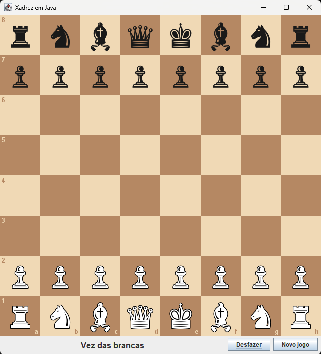

# Xadrez em Java

Jogo de xadrez para dois jogadores no mesmo computador, com interface gráfica (Java Swing) e todas as regras principais implementadas do zero.



## Funcionalidades

- Movimento de todas as peças
- Xeque, xeque-mate e empate por afogamento
- Roque (curto e longo), en passant e promoção do peão
- Só permite lances legais: o rei nunca fica em xeque
- Botões **Novo jogo** e **Desfazer**
- Seleção de peça com destaque das casas para onde ela pode ir

## Como executar

Requisito: JDK 8 ou superior instalado (`javac -version` deve funcionar).

```
cd src
javac Xadrez.java
java Xadrez
```

## Estrutura do projeto

```
src/
├── Xadrez.java           ponto de entrada (main) e montagem da janela
├── Board.java            tabuleiro e regras do jogo
├── Move.java             representação de um lance
└── PainelTabuleiro.java  interface gráfica (desenho e cliques do mouse)
```

A parte das regras (`Board`, `Move`) não depende da interface gráfica, o que facilita testes e uma futura versão com adversário computador.

## Como funciona

- O tabuleiro é uma matriz `char[8][8]`: letras maiúsculas são peças brancas, minúsculas são pretas e `.` é casa vazia.
- Os movimentos das peças são descritos por **vetores de deslocamento** `(linha, coluna)`. Bispo, torre e dama repetem o mesmo vetor até encontrar um obstáculo.
- Primeiro são gerados os lances "pseudo-legais" de cada peça. Depois cada lance é simulado em uma cópia do tabuleiro, e é descartado se deixar o próprio rei em xeque.
- O motor de regras foi conferido com contagens oficiais de lances (testes *perft*) em posições conhecidas, incluindo situações de roque, en passant e promoção.

## O que aprendi

- Modelar regras de um problema real em classes e métodos
- Separar a lógica do jogo da interface gráfica
- Trabalhar com matrizes e com vetores de deslocamento
- Testar um programa com casos conhecidos de referência

## Próximos passos

- [ ] Empate por material insuficiente, regra dos 50 lances e repetição tripla
- [ ] Notação dos lances e salvar/carregar partidas
- [ ] Testes automatizados (JUnit)
- [ ] Adversário computador com Minimax e poda alfa-beta

## Autor

Victor Antônio Lima do Nascimento · [LinkedIn](https://www.linkedin.com/in/victor-a-nascimento) · [GitHub](https://github.com/victor-a-nascimento)
